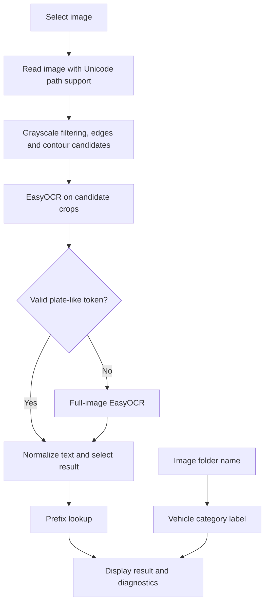

# Implementation notes

## Active GUI flow

`main_gui.py` calls `detect_plate_info`, which ranks up to eight contour candidates, evaluates candidate OCR and uses full-image OCR when none yields a plate-format match. Token assembly tries horizontal ordering, two-row joining and a best-token candidate. Candidate selection uses OCR confidence; the displayed score combines confidence and string length and can exceed 100.

`ocr_state.py` normalizes text (including a VV-to-W OCR correction) and maps the first letter of a plate. Its current table labels W as Kuala Lumpur, P as Penang, J as Johor and A as Ipoh. These are the assignment's prototype labels, not a complete authoritative registration database. Special multi-letter prefixes are not classified separately.

## Supporting and archived work

The standalone preprocessing module includes CLAHE, morphology and binarization. The segmentation module extracts character-sized contours. These modules are retained, but the current GUI does not call them directly. The `_removed_east` directory contains an earlier EAST experiment and model, not the active detection engine.

## Verification

The automated suite exercises pure mapping rules, OCR token assembly, malformed/missing image handling, and candidate versus fallback behavior. It injects sample OCR tokens rather than downloading neural models. A real EasyOCR smoke run is separate from those checks. Neither the unit suite nor the batch runner calculates labeled-dataset accuracy.
